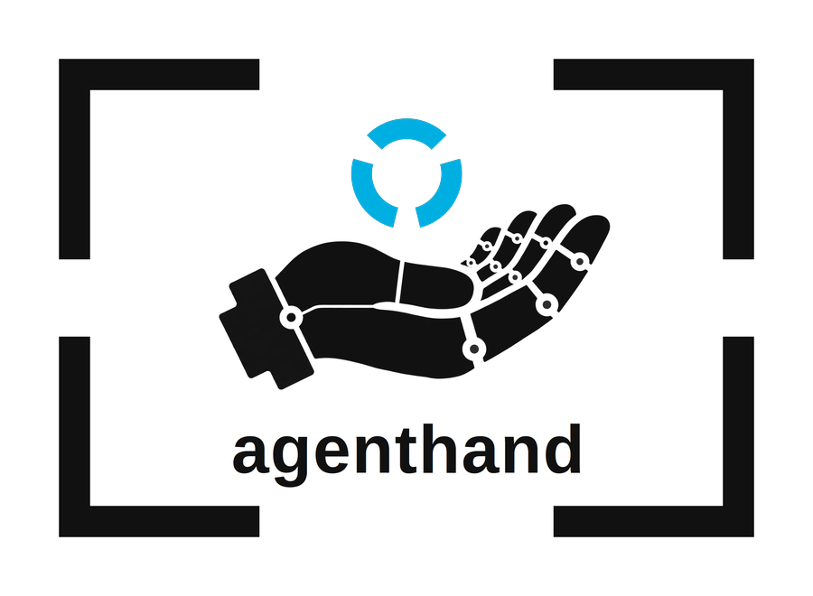

# agenthand

<p align="center">
  
</p>

An MCP server for AI agents that help people sell things.

The seller never opens agenthand. Their agent calls it. A seller hands their
agent a messy product photo; agenthand turns it into listing-ready material
through three tools, in the order a listing is produced:

| Tool | What it does |
|---|---|
| `draw` | Places the real product, pixel-untouched, into a generated scene (a chair in a regal room, a game lot on a clean table) and returns the composite with a fidelity receipt. |
| `cut_out` | Segments the product out of its photo and returns a transparent PNG, referenced by an asset handle. The concept is optional; without one, the planning step runs internally. |
| `identify` | The planning step inside the chain: reads a photo and plans the cut, returning a structured description plus the segmentation-ready noun-phrase concept (with alternates) that `cut_out` consumes. |

## Fidelity Lock

`draw` never regenerates the product. The invariant, enforced in code:

1. Segmentation extracts the real product foreground and its mask.
2. The product layer is stored untouched, with hashes recorded for the
   source, the foreground, and the mask: both the file-byte hash and the
   decoded-pixel hash of each.
3. The image model generates ONLY the background scene plate. Its
   interface takes a prompt and dimensions, never product pixels.
4. Deterministic code composites the original product layer onto that
   plate. The plate is resized and cropped to the product's dimensions;
   the product layer is never scaled.
5. `draw` refuses anything that is not a `foreground_png` asset chained
   back to a source photo, and verifies the stored hashes before a single
   pixel moves.
6. The result ships with a fidelity receipt: source, foreground, and mask
   hashes, the delivered file's own hashes, the transformations applied,
   the measured count of changed opaque foreground pixels, the model
   calls made, and their cost. The receipt also publishes what the count
   excluded: the edge-band pixel count and its maximum width, the opaque
   share of the mask, the exact changed-pixel predicate with tolerance 0,
   and the colour-profile identity of the source photo and the composite
   (a dropped or changed ICC profile recolours the product while pixel
   values stay identical, so it is recorded and counted as a fidelity
   failure).

The claim is precise: the stored extracted foreground reached the
composite unchanged, and its hashes pin exactly which layer that was.
Edge-band pixels (partially transparent) blend with the plate during
compositing; the receipt counts them separately instead of overclaiming.
The receipt's counts are measured on the delivered file, decoded back
from the store, and can be re-derived independently:
`composite.verify_receipt_from_disk` recounts from the stored files,
checks the receipt's own hashes against the assets it names, and
passes only on exactly zero changed pixels with real coverage; the
standalone `agenthand-verify SOURCE FINAL MASK` checker verifies
exported files with no store at all and likewise refuses a mask that
selects nothing. Ingest accepts the
formats phones produce, including HEIC, and preserves each photo's
embedded colour profile end to end.

A bounded mask-recovery loop guards `cut_out`: the mask is quality-checked,
and on a poor mask the tool retries once with an alternate concept phrase
from the planning step. Every attempt is traced in the receipt.

## Asset handles

Tools never pass image bytes back and forth. Every image is stored locally
(with a per-asset sidecar record, written atomically) and referenced as
`asset://<id>`. Handles chain between tools: `identify` reads one,
`cut_out` returns a new one, `draw` consumes it.

Photos get in through ingest: a tool's image argument may be an existing
handle, an http(s) URL, or a base64 data URI. Ingest caps the byte and
pixel size, applies EXIF orientation, and normalizes to 8-bit RGBA PNG.
Images get out two ways: `draw` returns an image preview with its result,
and every asset is readable by the client as the MCP resource at its own
`asset://<id>` URI.

## Cost receipts and the spend cap

Every billable call flows through one choke point
(`src/agenthand/meta_client.py`) using reserve-then-settle accounting:
under a file lock, the projected worst-case cost is checked against the
ledger and reserved as a pending receipt; after the call, a settlement
receipt records the actual cost priced from the provider's usage counts.
If a call fails after it may have billed, the reservation stays counted.
A call whose provider response carries no usable usage settles at its
reserved projection rather than $0: missing usage never erases spend.
Receipts land in a local JSONL ledger with tool, model, token and image
counts, USD estimate, and the pricing-table version used. Prices live in
one module (`src/agenthand/pricing.py`) so a price change is a one-line
edit with a version bump; an unpriced model raises rather than estimating
as $0. Every spend path shares the one ledger — the dry-run gate
included (its asset store is isolated in a temp dir, its ledger is not).

The server is fail-closed on spend. The working cap defaults to
**$120.00**; configuration may move it up or down but never past the
hard ceiling of **$150.00** (the hackathon credit amount), which no
configuration can exceed. Corrupt, negative, or non-finite ledger
entries refuse all spend: unknown spend state means no spend.

## Status

Hackathon build (Meta Global AI Developer Hackathon, Oct 26 - Nov 4,
2026). All three tools are wired to the real Meta Model API through the
spend-cap billing choke point — `identify` to muse-spark-1.3, `cut_out`
to sam-3.1, `draw` to muse-image-1.0 — and the full chain has run live
end to end. The verified run of 2026-10-26 (identify $0.007544,
cut_out $0.0025, draw $0.01; 580,613 opaque pixels checked, 0 changed)
is published with its fidelity receipt on the
[project site](https://ausernameforyou.github.io/agenthand/#fidelity),
where the same check can be re-run in the browser against the run's own
files. The placeholder plate survives only behind an explicit dev flag
for offline tests. Today the server runs locally over stdio; a hosted
endpoint comes later.

The server also exists as a single-binary Rust build (source in the
`agenthand-rust` repository). It passed a parity gate against the frozen
files of the verified run above, reproducing the run's counts and its
output pixel hash, and a live run from the Rust binary was cross-checked
by the Python verifier. The Python implementation remains the
reference; the Rust build is a second implementation of the same
server, and the two agree.

## Run it

Register agenthand with any MCP client. The primary route uses
[uv](https://docs.astral.sh/uv/): nothing to install ahead of time, uv
fetches the published package and runs it.

```json
{
  "mcpServers": {
    "agenthand": {
      "command": "uvx",
      "args": ["agenthand"],
      "env": { "META_API_KEY": "…" }
    }
  }
}
```

Or install the package with pip and point the client at the installed
command:

```bash
pip install agenthand
```

```json
{
  "mcpServers": {
    "agenthand": {
      "command": "agenthand",
      "env": { "META_API_KEY": "…" }
    }
  }
}
```

The server starts and lists its tools without a key; the key is only
needed when a tool makes a model call. Configuration is by environment
variable; see `.env.example`.

### From source (dev)

```bash
git clone https://github.com/AUsernameForYou/agenthand
cd agenthand
python3.12 -m venv .venv
.venv/bin/pip install -e ".[dev]"
.venv/bin/agenthand          # stdio transport
.venv/bin/pytest             # unit tests
```
