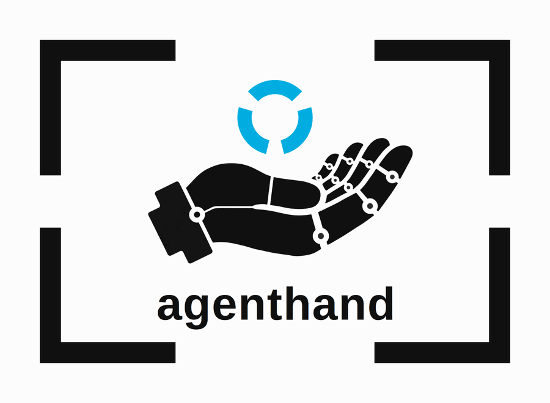

# agenthand

<p align="center">
  
</p>

An MCP server for AI agents that help people sell things.

The seller never opens agenthand. Their agent calls it. A seller hands their
agent a messy product photo; agenthand turns it into listing-ready material
through three tools, in the order a listing is produced:

| Tool | What it does |
|---|---|
| `draw` | Places the real product, pixel-untouched, into a generated scene (a chair in a regal room, a game lot on a clean table) and returns the composite with a fidelity receipt. |
| `cut_out` | Segments the product out of its photo and returns a transparent PNG, referenced by an asset handle. The concept is optional; without one, the planning step runs internally. |
| `identify` | The planning step inside the chain: reads a photo and plans the cut, returning a structured description plus the segmentation-ready noun-phrase concept (with alternates) that `cut_out` consumes. |

## Fidelity Lock

`draw` never regenerates the product. The invariant, enforced in code:

1. Segmentation extracts the real product foreground and its mask.
2. The product layer is stored untouched, with hashes recorded for the
   source, the foreground, and the mask: both the file-byte hash and the
   decoded-pixel hash of each.
3. The image model generates ONLY the background scene plate. Its
   interface takes a prompt and dimensions, never product pixels.
4. Deterministic code composites the original product layer onto that
   plate. The plate is resized and cropped to the product's dimensions;
   the product layer is never scaled.
5. `draw` refuses anything that is not a `foreground_png` asset chained
   back to a source photo, and verifies the stored hashes before a single
   pixel moves.
6. The result ships with a fidelity receipt: source, foreground, and mask
   hashes, the transformations applied, the measured count of changed
   opaque foreground pixels, the edge-band pixel count, the model calls
   made, and their cost.

The claim is precise: the stored extracted foreground reached the
composite unchanged, and its hashes pin exactly which layer that was.
Edge-band pixels (partially transparent) blend with the plate during
compositing; the receipt counts them separately instead of overclaiming.

A bounded mask-recovery loop guards `cut_out`: the mask is quality-checked,
and on a poor mask the tool retries once with an alternate concept phrase
from the planning step. Every attempt is traced in the receipt.

## Asset handles

Tools never pass image bytes back and forth. Every image is stored locally
(with a per-asset sidecar record, written atomically) and referenced as
`asset://<id>`. Handles chain between tools: `identify` reads one,
`cut_out` returns a new one, `draw` consumes it.

Photos get in through ingest: a tool's image argument may be an existing
handle, an http(s) URL, or a base64 data URI. Ingest caps the byte and
pixel size, applies EXIF orientation, and normalizes to 8-bit RGBA PNG.
Images get out two ways: `draw` returns an image preview with its result,
and every asset is readable by the client as the MCP resource at its own
`asset://<id>` URI.

## Cost receipts and the spend cap

Every billable call flows through one choke point
(`src/agenthand/meta_client.py`) using reserve-then-settle accounting:
under a file lock, the projected worst-case cost is checked against the
ledger and reserved as a pending receipt; after the call, a settlement
receipt records the actual cost priced from the provider's usage counts.
If a call fails after it may have billed, the reservation stays counted.
Receipts land in a local JSONL ledger with tool, model, token and image
counts, USD estimate, and the pricing-table version used. Prices live in
one module (`src/agenthand/pricing.py`) so a price change is a one-line
edit with a version bump; an unpriced model raises rather than estimating
as $0.

The server is fail-closed on spend. The working cap defaults to
**$120.00** and can only be lowered by configuration; a hard ceiling of
**$150.00** (the hackathon credit amount) cannot be exceeded. Corrupt,
negative, or non-finite ledger entries refuse all spend: unknown spend
state means no spend.

## Status

Hackathon build in progress (Meta Global AI Developer Hackathon, Oct 26 -
Nov 4, 2026). `draw`'s Fidelity Lock pipeline (lineage checks, integrity
verification, deterministic compositing, fidelity receipt) runs locally
end to end with a deterministic placeholder background plate; its
background model is not wired yet. `identify` is wired to the real vision
model (muse-spark-1.3) and `cut_out` to the real segmentation model
(sam-3.1), both through the spend-cap billing choke point; cut_out's live
verification is still pending.

## Run it

```bash
python3.12 -m venv .venv
.venv/bin/pip install -e ".[dev]"
.venv/bin/agenthand          # stdio transport
.venv/bin/pytest             # unit tests
```

Configuration is by environment variable; see `.env.example`.
